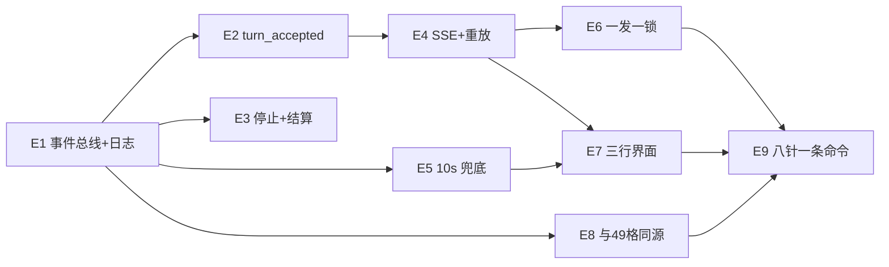

> 怎么跑：`说明书-闸与尺子怎么跑-1022.md` ｜ 接手读：`交接-agentd事件层-1022.md`

# 事件层-1022 · agentd 协同事件面（计划 + 架构图）

跑法：E1（事件总线 + append-only 日志）**已落到真树并复验**（`验收-E1-1022.md` 有全套读数）；
E2–E9 仍只是计划与图。要开工读 `计划-agentd事件层.json` 里第一条 `status=Planned` 的故事（现在 = E4），
动手前读 `..\微内核\微内核\AGENTS.md`（冻结边界）与 `..\研究-协同工作-1022.md` §5/§8（契约与针）。

| 文件 | 答什么 |
|---|---|
| `计划-agentd事件层.json` | 9 个故事 E1–E9：任务序、依赖、一发一边界（create-plan 产物）、每条 `status` |
| `event-layer-target.dot` | 目标态容器图：实线=已在盘上，蓝虚线=计划新建，红点线=冻结边界 |
| `event-flow-one-shot.dot` | 一发之内的事件序 + 三条反臂（受理/回边/不补步） |
| `event-layer.evidence.json` | 机器可读证据模型：节点/边/引用条数由 `证据模型核对.py` 现印，这里不抄 |
| `evidence.md` | 全部 `path:line` 证据、自印的分母、置信度、仍未核清的空洞 |
| `锚点核对.py` | 尺子一：`evidence.md` 每条 `path:line` 回盘验（行界 + 符号命中，臂数由读数自己印） |
| `证据模型核对.py` | 尺子二：`event-layer.evidence.json` 的可解析性/端点闭合/状态口径/分档；**符号可核那条数必须等于 `锚点刷新.py` 自印的 `refs total=`**，不等就是有槽没进档（10-23 就是靠这条对账抓到追加式 SPEC 读不到） |
| `尺子自证-旧病复现-1023.py` | 把尺子二修掉的两个旧病（追加式 `SPEC["x"] = […]` 读不到 / `mis` 重复键覆盖判据）**注回内存副本**跑三遍：注病必红、基准必绿。判「有没有牙」看 `sym_bad>0 而 mis=0` 那一对数，不看 rc |
| `臂检崩溃自证-1023.py` | 证明臂检件「跑一半被打断也把 `%TEMP%` 树副本带走」**且**「打断也不毁上一份臂读数」：三头判 —— 新件（不留副本 + 上一份读数 md5 未动 + 无 `.part` 残留）／负对照 A（改动前那份：既无 atexit 也无原子发布 ⇒ 副本必留、读数必被截成 0 字节）／负对照 B（只有 atexit 那份：副本照样带走，但读数**仍**被截成 0 ⇒ 两笔账分开）。对照原件从 `TEMP-备份/文档-1023/` 取，取不到就 rc=4／点名不判。**没进 `体检-全闸`**：它要起三份 `go test`，紧跟臂检会抢构建缓存；改过 `臂检-全部族.py` 就手动跑一次 |
| `臂读数空档自证-1023.py` | 证明 `体检-全闸` 那一行「臂读数」不再只看 mtime：六形喂两遍（空档 / 含 BLIND / 含 NOT-WIRED / 全 BIT 且新 / 全 BIT 但旧 / 读数不在盘上），修后件必按 `EMPTY·BAD·BAD·FRESH·STALE·MISSING` 点名且前三与末一形计入红，修前件对同一份编造读数一条都报不出来 ⇒ 牙是新长的，也没把「旧」与「坏」塌成一态。假树假读数全在 `%TEMP%`，不碰真读数，不跑 go |
| `锚点刷新.py` | 把模型的 `sourceRefs` 按盘上现数重新指到行；SPEC 槽位清单同时是尺子二的符号档，符号找不到就 rc=2 且不写盘（`--dry` 是它的反臂） |
| `臂检-全部族.py` | **臂件只有这一件**：变异自证（把修好的那处改回坏法，逐根问「对应那支针红不红」），先跑未变异对照再落变异，两头的数都印；`--anchors-only` 是预检档（只核每根锚的命中数，报 NOT-WIRED） |
| `验收-事件层-1022.py` | **八条针一条命令**（E9）：道数与针名从研究件 §8.2 现读、臂数从臂检读数现数、点出「事件层里没进任何一条针的 Test」；结论落 `报告-验收.txt` |
| `体检-全闸-1023.py` | 全套闸一条命令（vet / go test / kcheck / 尺子一 / 尺子二 / 尺子自证 / 八条针 / 臂检），**道数不写死在这儿**——以 `报告-全闸.txt` 自己印的那几行为准，最后一行是合取结论；另核「臂读数比树新不新」，过期就降级成参考。`--skip-arms` 会明写这趟没重跑变异 |
| `冒烟-事件层-1022.py` | 端到端：建 exe（打印 sha256）逐步跑真读数 —— stdout 不变 / 跨进程 append / 撞车守卫 / 横幅三态 / 六态退出码 / 收口形状。**道数不写死在这儿**：`读数/冒烟-事件层.jsonl` 一行一步，行数即道数 |
| `E4真负载核对.py` | 真 exe 上的跨趟负载（`-check-log` 判、counts 独立复算、谎报与半路被杀两头必须红、投送层在跑的过程中读得到）；三态分打印 过/红/未测；末行 `landing check` **从落盘那份重数**（10-23 之前它只印路径不写文件，盘上留的是旧件化石 —— 交接 §2h）；`S16b` 是 S16 的叶子反臂 |
| `测量-回执预算-1023.py` | §7.3 欠的那一发：建一次 exe、等编译退净、连跑 N 趟（**每趟起测前 `tasklist` 数一次 go/compile/link/agentd 进程**当「没人抢」的凭证），把 `ack_ms` 按**发位分层**报分布（第一发 / 后续发 / 全样本三个口径分开，别拿混着数的 p50 冒充宿主快）。三臂：预算 0 必红**且那句必须报出 >0 的毫秒数**、预算 60000 必绿、**同一本最慢的账做 F-1 红 / F 绿 阈值穿越**（证 `-ack-limit-ms` 旗标真接在判据上）。rc 只答「这趟量可不可信」，破预算本身是**发现**不算件红 —— 读数里 `VERDICT` 那句自己说守住还是偶发破 |
| `验收-E1-1022.md` | E1 的边界、M2 双路合并处置表、推广之后的全套读数、仍欠的 |
| `验收-E2-1022.md` | E2（回执）的边界与读数；含「A7 一直是假咬」这一条怎么被抓出来的 |
| `验收-E3-1022.md` | E3（停止入口 + 结算）的读数，以及 M2 路 B 两条「臂指错负载/墙钟对撞」的还债 |
| ~~`臂检-C族-E3.py` 等五件散臂检~~ | **已软隔离**到 `../TEMP-备份/臂检散件-1022/`（并进 `臂检-全部族.py` 之后不留两份闸；要回退就把那五个文件移回来）|
| `契约对照-E1E2-1022.md` | 研究件 §5 逐条对到实现：已合 / 形状不符 / 本来没这回事 三态 |
| `读数/` | 本面所有尺子的最近一次自印读数（「最新」只按 mtime 认；推广前那两趟红读数也留着，文件名点名） |
| `README.md` | 本文件 |

## 尺子与臂件怎么跑（工作目录 `事件层-1022`）

```bash
# 工作目录 事件层-1022
C:/Users/Admin/sdk/py314/python.exe 锚点核对.py
C:/Users/Admin/sdk/py314/python.exe 证据模型核对.py
C:/Users/Admin/sdk/py314/python.exe 尺子自证-旧病复现-1023.py
C:/Users/Admin/sdk/py314/python.exe 臂读数空档自证-1023.py   # 不起 go：编造六形读数，喂修后件与修前件各一遍
C:/Users/Admin/sdk/py314/python.exe 锚点刷新.py
# 下面这几件都跑在真树上（不是沙箱）；哪一行要带 go.exe 与树根就看那一行本身，件数别在这儿数
C:/Users/Admin/sdk/py314/python.exe 臂检-全部族.py --anchors-only C:/Users/Admin/sdk/go/bin/go.exe "C:/Users/Admin/Desktop/微内核/微内核/微内核"
C:/Users/Admin/sdk/py314/python.exe 臂检-全部族.py C:/Users/Admin/sdk/go/bin/go.exe "C:/Users/Admin/Desktop/微内核/微内核/微内核"
C:/Users/Admin/sdk/py314/python.exe 冒烟-事件层-1022.py C:/Users/Admin/sdk/go/bin/go.exe "C:/Users/Admin/Desktop/微内核/微内核/微内核"
C:/Users/Admin/sdk/py314/python.exe E4真负载核对.py   # 不用带参数：件里默认就是真树，自己 go build 一份 exe
C:/Users/Admin/sdk/py314/python.exe 测量-回执预算-1023.py 30   # 单独一发（§7.3）：只在你想重量 ack_ms 分布时跑，不是闸
```

退出码 0 = 过；3 = 有坏件或**臂没红**（臂不红的「通过」不作数）；4 = 被检件读不到。
合取件里 `arm-reading` 那一行分五态点名（10-23 起）：`FRESH` 新且全咬 / `STALE` 真说过话但比树旧 ⇒ 只 WARN，仍只作参考 /
`EMPTY` 一行臂都没有 / `BAD` 读数里有不绿的档（报告里点名是哪一桶）/ `MISSING` 读数不在盘上 —— 后三态**计入红**，
因为「空读数 + 最新 mtime」正是臂跑到一半被打断留下的形状。
分母（锚点行数、引用条数、臂数、步数、回执那件的趟数与发数）一律由上面各件自己印 —— 本 README 不抄数，抄一次就冻一次。
最近一趟的落盘位置：`读数-锚点核对.txt`、`读数-证据模型核对.txt`（这两件写在**本面根目录**，不在 `读数/` 里）、
`读数/尺子自证-旧病复现-1023.txt`、`读数/臂读数空档自证-1023.txt`、`读数/臂检崩溃自证-1023.txt`、`读数/臂检-全部族.jsonl`、`读数/冒烟-事件层.jsonl`、`读数/E4真负载.jsonl`、`读数/测量-回执预算-1023.txt`、
`臂检-全部族-读数.md`、`报告-全闸.txt`、`报告-验收.txt`。E5 那一发的真负载读数在 `读数/真负载-E5兜底进度-1022.txt`（带 exe 字节数与 md5）。
`读数/锚点核对.txt`、`读数/证据模型核对.txt` 是**旧归档**（同名不同路径，mtime 停在 10-22 17:58）——
认「最新」只按 mtime，别按目录名猜；这一句是本轮现数的：根目录那两份 00:38、`读数/` 那两份 17:58。
**「未变异对照必须绿」这件事由 `臂检-全部族.py` 自己数**：它先跑对照再落变异，两列都印 —— 只印变异那列的读数不作数。

## 需求编号 → 故事（`covers` 字段用的就是这套号）

`1-8` = 研究件 §8.1 那八行动作（P0×4 / P1×3 / P2×1）；`9-16` = §8.2 那八条验收针（回执/序号/缺席/结算/补步/续传/混列/投影）。
映射表已写进 JSON 的 `requirementIndex`，不必回头翻散文。

## 依赖链（blocker 在前）



（Mermaid 只是给人看的轻量视图；**DOT 才是可维护图源**，两份内容同源。）

## 状态口径

- 当前态：`cmd/agentd` 已有六态退出码、SIGINT 先交账、checkpoint+resume、每发 49 格的事后轨迹页，
  **外加 E1 的事件总线与 append-only 事件日志**（七个挂点、五档门禁、状态白名单、落点撞车守卫、三态横幅）。
- 目标态：**E1 / E2 已 Exercised 且过完 M2 双路互审（合并修法见 `验收-E2-1022.md` 末节）**；**E3 = Exercised（26 根臂 + S8），待 M2**（Present + Wired + Exercised —— 13 支测试真跑、10 根变异臂全咬、7 步真 exe 冒烟全过、
  锚点 20/20、模型 80 条引用可解析）。E4–E9 仍 = **Planned**，三个词一个都不成立。
- 未确证（不许被 E1 的绿带走）：`eventBus` 竞态（`-race` 本机需 cgo，跑不了）；账本写失败仍 `rc=0` 是既有洞，
  改退出码等作者拍；stdout 那根针看不见「只改账本体积数字」那一类污染。
- 未渲染：本机无 graphviz（`which dot` 空），两张 DOT 没出过 SVG，布局未经肉眼核验。
- 真模型端点 NOT_RUN、真人可读性 0/1 —— 事件层做完也只到机械正确，别说成协同体验已验证。
