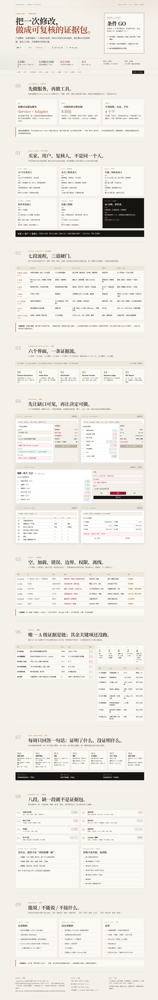

# Agentkernel 产品级设计 · 2026-10-20

本目录回答一个问题：**Agentkernel 作为一个“证据包服务 + 6 周试点”的产品，整体怎么设计、怎么跑、怎么判定。**

它不是单页决策卡的优化，也不替代市场报告。市场报告回答“卖什么、卖给谁、多少钱”；本目录回答“服务怎么交付、界面怎么长、证据怎么记、试点怎么停”。

---

## 1. 先看哪个

| 想做什么 | 打开 |
| --- | --- |
| 看完整设计（推荐，可点、可打印） | `产品设计蓝图.html`（双击，自包含，无外链） |
| 看结论与证据台账 | `产品级-二次评估.md` |
| 看服务流程 / 界面 / 状态 / 度量 / 试点 | `产品设计蓝图.md`（HTML 的源文档） |
| 看 28 个插件 Skill 的触发判定与目标 | `产品设计-触发场景-产品级.md` |
| 打印 / 邮件附件 | `产品设计蓝图.pdf`（A4，15 页） |

**HTML 是主设计件，PDF 只作打印便利。** 本机 Edge 导出的 PDF 文本层 CJK 为 0（`pdftotext` 只出拉丁片段；市场报告 PDF 同样如此），因此可复制、可检索、可引用的源是 HTML / MD，不是 PDF。



---

## 2. 产物清单

| 文件 | 字节 | 状态 | 说明 |
| --- | ---: | --- | --- |
| `产品级-二次评估.md` | 26,552 | 完成 | 条件 GO；五道闸；风险 R1–R12；开放项 O1–O10 |
| `产品设计蓝图.md` | 28,532 | 完成 | 16 节：Brief / 结构 / 服务蓝图 / 旅程 / 流程 / 六面 / 六态 / 证据包 / 度量 / 试点 / 安全 / 停止 / 边界 / 映射 / 开放项 |
| `产品设计蓝图.html` | 55,914 | 完成，QA 通过 | 自包含；10 节；5 张表；46 个标题；三档视口无横向溢出 |
| `产品设计蓝图.pdf` | 1,091,453 | 完成，打印件 | A4 纵向 15 页；第 1 页目视核对；文本层仅拉丁 |
| `产品设计-触发场景-产品级.md` | 13,034 | 完成 | 28 个 Skill：已应用 5 / 部分 6 / `NOT_RUN` 4 / 不触发 13 |
| `render/qa-final.txt` | 5,290 | 原始读数 | 1440 / 1024 / 375 三档 QA 输出 |
| `render/蓝图-*.png`、`render/节-s*.png`、`render/print-sections/*` | — | 截图 | 桌面全页 / 首屏 / 窄屏 / 10 节 / 10 张打印媒体分节 |

### 核心 SHA-256

```text
2868a46343894b0d077ac3f9eb6652b106437a3ca8fa31785616b84efc3cecc8  产品级-二次评估.md
580a196a8359464da933237dade7ba1b31c306ed5eeafb282cd47d030a32c52c  产品设计蓝图.md
c7d95e1047e0b0749df0705970b34503490cc406704e0ad54db67800b432b0ac  产品设计蓝图.html
4fd388cc4c4ca01073334804409f4ce176f5daae705eb37970f741b6ed28c6ad  产品设计蓝图.pdf
7ece10c3740c6a8d4b65143480d9b61813c1aee4fcecef8aa1d72e28e03a0686  产品设计-触发场景-产品级.md
```

完整清单见 `SHA256SUMS`（含截图 / 脚本）；复核：

```bash
cd "C:/Users/Admin/Desktop/微内核/市场报告-1020/产品设计-1020"
sha256sum -c SHA256SUMS
```

---

## 3. 产品结论（短版）

**条件 GO：只批准一个 6 周付费试点；不批准平台化、不批准企业私有化（B）、不做按调用托管（C）。**

三个前置条件，缺一不启动：

1. 客户提供一次**真实修改**：改前 / 改后产物 + 一次失败复盘；
2. 客户指派 **1 名非作者复核人**，且能保证 60 分钟；
3. 客户接受**数据条款**（驻留、30 天留存、5 天删除、无子处理方、责任上限）与**非声明**（不是防线、不是认证）。

产品形态是 **concierge 证据包服务 + 薄适配层**，不是自助 SaaS。先做服务，再做工具；先让复核人能在 60 分钟内独立判断，再谈规模化。

---

## 4. 证据状态（不许塌成一态）

| 事项 | 当前读数 | 等级 | 状态 |
| --- | --- | --- | --- |
| 账本链自洽 | 2,940 / 2,940 | A | 已复算（60 调用 × 49 格；12 会话；4 角色） |
| 8799 实例 | 490 条 / 6 调用 | B | 单源自印；未独立复算 |
| 产物原像 | 0 / 2,940 | B（读数）/ X（账外） | 账内没有原像；账外是否另有原件未验证 |
| 版本三元组 | 0 / 3 | B（读数）/ X（账外） | 账内产物 / 行为 / 判据三版均缺；账外未验证 |
| 拒收计数 | 无字段 | — | absent；不写成 0 |
| 买家访谈 | 0 / 10 | X | `NOT_RUN` |
| 非作者复核人 | 0 名 | X | `NOT_RUN` |
| R/N 双臂 | 0 / 10 | X | `NOT_RUN` |
| POC / LOI / 付费试点 | 0 / 0 / 0 | X | `NOT_RUN` |
| 市场规模 / 定价 | C 级假设 | C | 来自市场报告，不是实测 |
| EU AI Act / OTel | 外部公开 | D | 只作背景，不作合规结论 |

> 0 / 2,940 与 0 / 3 是**账内读数**（可复算）；账外是否另有原像 / 版本记录为 X，未验证。两者不能合并成一句“没有原像”。

**唯一 A 级证据是链。** A2–A6、P1–P8、60 分钟、复核通过率、R/N 增量全部未测。桌面推演拿现有账本走证据包，只过 1 / 8 段；这是本轮最重要的负读数。

---

## 5. HTML 验收读数（2026-10-20 重跑）

原始输出：`render/qa-final.txt`。

| 视口 | 文档宽 / 视口宽 | 横向溢出 | 外部资源 | 控制台 | 节 / 表 / 标题 |
| --- | --- | --- | --- | --- | --- |
| 1440 × 900 | 1425 / 1425 | 否 | 0 | 0 条 | 10 / 5 / 46 |
| 1024 × 900 | 1009 / 1009 | 否 | 0 | 0 条 | 10 / 5 / 46 |
| 390 × 844 | 375 / 375 | 否 | 0 | 0 条 | 10 / 5 / 46 |

- 桌面全页尺寸：1425 × 8,969 px；
- 打印媒体按 A4 794 px 复核：服务蓝图 6 列、六态 7 列、A1–A6 / P1–P8 表均不裁列；证据阶梯恢复 5 列；
- PDF 页数 15（按 `/Type /Page` 对象实数）；第 1 页目视正常；
- **未逐页目视 PDF 第 2–15 页**；其余页面以打印媒体分节截图核对，不宣称逐页验收。

截图：

- `render/蓝图-桌面1440-全页.png`（整页）
- `render/蓝图-桌面1440-首屏.png`
- `render/蓝图-窄屏390-首屏.png`
- `render/节-s0.png` … `render/节-s9.png`（1440 分节）
- `render/print-sections/节-s0.png` … `节-s9.png`（A4 打印媒体）

---

## 6. 触发映射总账

分母：插件 `product-design` 0.5.10 的 `skills/` 目录实际 28 个 `SKILL.md`（`ls | wc -l = 28`）。

| 判定 | 数量 | Skill |
| --- | --- | --- |
| 已应用 | 5 | `journey` `sitemap` `flow-web` `edge` `metric` |
| 部分应用 | 6 | `frame` `brief` `stories` `check` `access` `pitch` |
| `NOT_RUN` | 4 | `probe` `test` `bench` `prd` |
| 不触发 | 13 | `scope` `audit` `signal` `board` `chart` `flow-mobile` `avatar` `poster` `motion-plan` `motion-apply` `qa` `retro` `extract` |
| **合计** | **28** | — |

5 + 6 + 4 + 13 = 28。

**与卡片级映射不可相加**：卡片级对象是单页 A4（1 / 4 / 23），本目录对象是服务 + 试点 + 六面；两级同一 Skill 的判定可以不同。

目标已挂到闸门：G0 访谈与真实触发 → G1 非作者 60 分钟组包 → G1.5 R/N 10 例 → G2 LOI / 安全审查 → G3 付费与续费。详见映射文件 §3 / §5。

---

## 7. 开放项（会改变结论的）

| # | 问题 | 谁答 | 何时 |
| --- | --- | --- | --- |
| Q1 | trace ID 如何与账本对齐 | 客户平台 + 证据工程师 | W1 |
| Q2 | 原像由谁保管、如何证明新鲜 | 客户 + 法务 | W0 |
| Q3 | 版本三元组的最小 schema | 作者 + 客户 | W1 |
| Q4 | 复核人资格与培训 | 客户 + 作者 | W0 |
| Q5 | 拒收争议谁裁决 | 双方技术代表 | 签约前 |
| Q6 | 实例 ID / 两本账 | 工具层 | W2 |
| Q7 | R/N 样本不足怎么办 | 作者 | W5 |
| Q8 | 定价与工时 | 作者 + 客户 | W6 |
| Q9 | PDF 文本层 | 交付方 | W6 |
| Q10 | 客户要求认证怎么办 | 作者 | 资格通话 |

完整清单另见 `产品设计蓝图.md` §15 与 `产品级-二次评估.md` 的 O1–O10。

---

## 8. 已知限制

1. **PDF 文本层不可检索**：CJK 字符为 0，原因是本机 Edge PDF 导出；HTML / MD 才是文本源。
2. **线框是示意**：S1–S5 用占位数据说明字段与状态，不是已实现界面，也不是可用性测试对象。
3. **HTML 验收是渲染级**：三档视口、无外链、无控制台报错、表格不裁列；未做完整 WCAG 审计，仅算了 9 组色对（4.59–16.15:1）。
4. **没有真人数据**：0 访谈、0 复核人、0 R/N、0 客户；任何“60 分钟”“可复制”“有需求”都还是目标或假设。
5. **AI 模拟读者不是人类**：不计入通过率，不替代 `test`。
6. **审计层不是防线**：本产品不宣称覆盖 MCP01 / 03 / 06，只处理“承诺 / 依据 / 记录”的记账问题（对应 MCP08 一类）。
7. **不是合规意见**：EU AI Act 第 12 条只作触发背景，不构成法律结论。

---

## 9. 复跑

依赖：本机 Edge（`C:\Program Files (x86)\Microsoft\Edge\Application\msedge.exe`）、Node（当前 shell 可用）、`pdftotext`（可选，用于文本层检查）。

```bash
cd "C:/Users/Admin/Desktop/微内核/市场报告-1020/产品设计-1020"

# 1. 三档视口 QA + 全页 / 首屏截图
node render/qa_cdp.js "产品设计蓝图.html" "render"

# 2. 1440 分节截图
node render/shots_sections.js "产品设计蓝图.html" "render"

# 3. A4 打印媒体分节截图
node render/shots_print.js "产品设计蓝图.html" "render/print-sections"

# 4. 重新导出 PDF（A4，15 页）
node render/print_check.js "产品设计蓝图.html" "产品设计蓝图.pdf"

# 5. 哈希复核
sha256sum -c SHA256SUMS
```

复跑后若改动 HTML / MD，必须重新导出 PDF 并更新 `SHA256SUMS`；否则哈希对不上是预期行为，不是“文件损坏”。

---

## 10. 边界

> 本目录是研究与设计件，不是报价单、投资建议、合规意见或交付承诺。所有 X 项均未验证；未测到的不写成 0；线框不是已实现界面；AI 模拟不是真人；PDF 不是可检索源。
